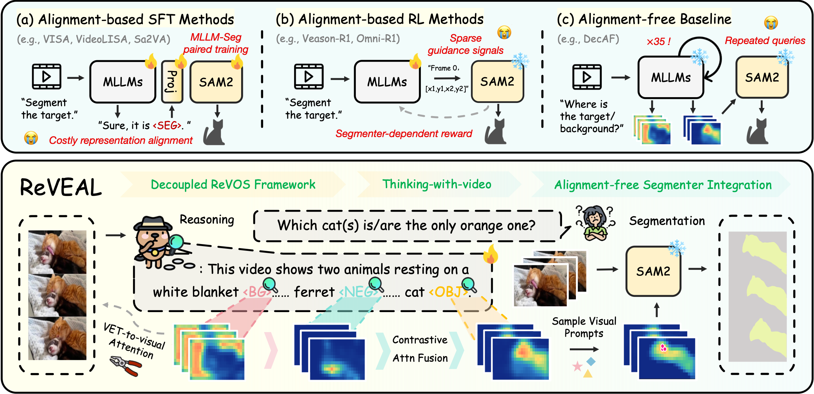

# ReVEAL

<div align="center">

Official implementation of **ReVEAL: Eliciting Role-Aware Latent Visual Evidence from MLLMs for Reasoning Video Object Segmentation**.

<p>Zhongyuan Bao<sup>1</sup>, Cunjie He<sup>1</sup>, Lejun Zhang<sup>2</sup>, Zenglin Xu<sup>1</sup>, Yanwei Fu<sup>1</sup></p>
<p><sup>1</sup> Fudan University &nbsp;&nbsp; <sup>2</sup> New York University</p>

<!-- 发布后，将按钮目标替换为 arXiv 论文链接和 Hugging Face 模型链接。 -->
<p align="center">
  <a href="#todo"></a>&nbsp;
  <a href="#todo"></a>
</p>

</div>

## Overview



ReVEAL unlocks MLLMs’ inherent grounding ability, eliciting latent visual evidence for target, background, and distractor regions during reasoning to guide an external video segmenter.

## TODO

- [ ] Release evaluation code.
- [ ] Release training code.

## Acknowledgements

We thank the authors of [DecAF](https://github.com/HYUNJS/DecAF), [InterRVOS](https://github.com/cvlab-kaist/InterRVOS), and [QwenVL](https://github.com/QwenLM/Qwen3-VL) for sharing their code and models.

## Citation

BibTeX placeholder (to be updated):

```bibtex
@misc{reveal,
  title={ReVEAL: Eliciting Role-Aware Latent Visual Evidence from MLLMs for Reasoning Video Object Segmentation},
  author={TODO},
  year={TODO},
  eprint={TODO},
  archivePrefix={arXiv}
}
```
